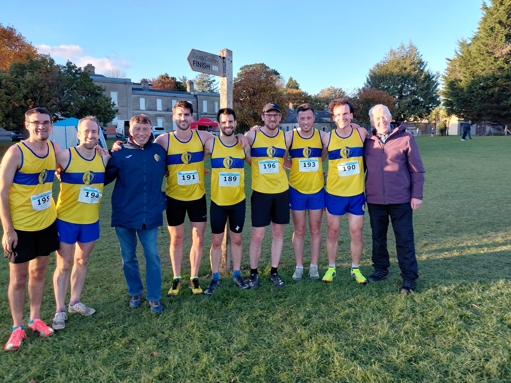
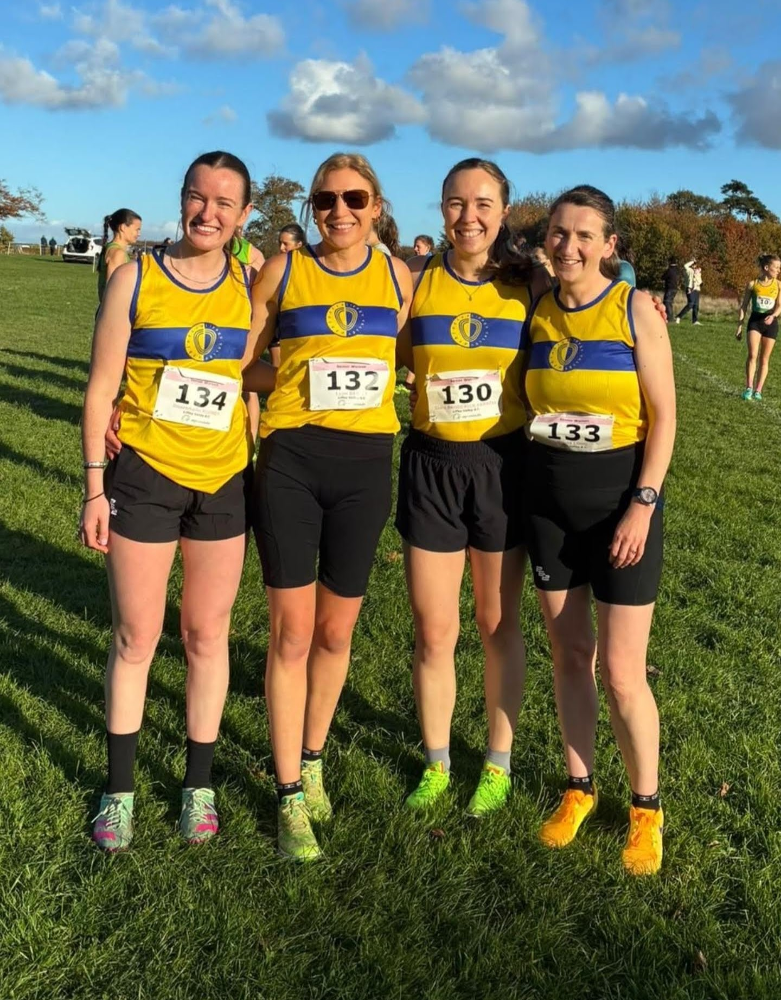

A fantastic day for <b>Liffey Valley AC</b> at the <b>Dublin Senior Cross Country Championships</b>, held on <b>Sunday, 1st November 2026</b> at the National Sports Campus in Abbotstown! A total of <b>12 club athletes</b> competed over the challenging 7.5km course, delivering excellent performances in both the men's and women's races.  

The championships took place on a beautiful autumn day, with <b>pleasant sunshine and excellent underfoot conditions</b>, providing a great setting for some competitive cross-country racing.  

Our <b>men's team secured an impressive 5th place overall</b>, narrowly missing out on fourth place to Crusaders AC by just two points! <b>Pierce Geoghegan</b> led the team home in <b>15th place (24:49)</b>, followed by <b>David Carroll (17th, 25:05)</b>, <b>Geoffrey Alexandre (31st, 26:04)</b> and <b>Paul Bolger (37th, 26:38)</b>. Strong performances also came from <b>Richard Finegan, Joseph McDermott, James McKenna and Antoine Daubigny</b>.  

Our <b>women's team finished an excellent 4th overall</b> in a competitive championship! <b>Ciara Broderick Farrell</b> was our first finisher in <b>18th place (32:16)</b>, closely followed by <b>Lynn Devitt (19th, 33:19)</b>, <b>Dearbhaile Rooney (20th, 33:26)</b> and <b>Brigid Long (22nd, 35:18)</b>. A brilliant collective effort from all four athletes!  

At the front of the men's race, <b>Paul O'Donnell of Dundrum South Dublin AC</b> claimed the Dublin Senior title in <b>23:13</b>, ahead of Colm Rooney and Fintan Kerins of Clonliffe Harriers. <b>Elizabeth Gahan of Dublin City Harriers</b> won the women's championship in <b>26:45</b>, followed by Catherina McGurn and Orla Duffy.  

The team titles went to <b>Clonliffe Harriers in the men's race</b>, securing their eighth consecutive victory, and <b>Dublin City Harriers in the women's race</b>, successfully defending their title.  

<b>Congratulations to all our Liffey Valley AC athletes!</b> Two strong team results, plenty of determination and another great day representing the club in Dublin athletics. A big thank you also to the coaches, volunteers and supporters who helped make the day a success! 💚🏃‍♂️🏃‍♀️

<a href="https://myrunresults.com/events/dublin_u19_u20__senior_xc_/6393/details" target="_blank" rel="noopener noreferrer">My Run Results</a>

<a href="https://www.instagram.com/p/DfP2eAyEWQ4/?img_index=1" target="_blank" rel="noopener noreferrer">Instagram</a>

<a href="/races/2026-11-01-Dublin-Senior-XC/" target="_blank" rel="noopener noreferrer">Race Results</a>

<figure style="text-align: center;">
  
  <figcaption style="font-size: 1.2em; color: #ceb329; margin-top: 6px;">
    Men's Team
  </figcaption>
</figure>

<figure style="text-align: center;">
  
  <figcaption style="font-size: 1.2em; color: #ceb329; margin-top: 6px;">
    Women's Team
  </figcaption>
</figure>