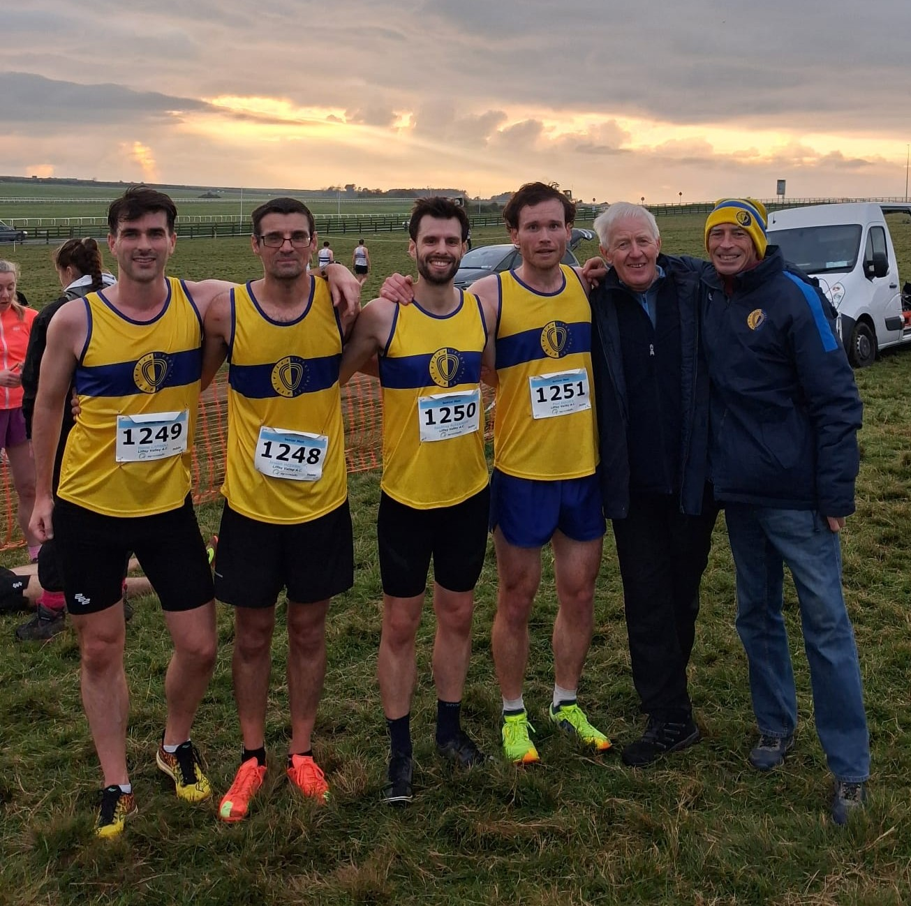

A fantastic team performance from <strong>Liffey Valley AC</strong> at the Leinster Senior Cross Country Championships, held at the historic Curragh Racecourse in Co. Kildare. Our four athletes took on the challenging <strong>9.2km course</strong>, competing against some of Leinster's strongest distance runners.

<strong>David Carroll</strong> led the team home with an excellent <strong>10th-place finish in 31:43</strong>, securing a well-deserved top-ten position. <strong>Geoffrey Alexandre</strong> followed with another strong performance, finishing <strong>22nd in 32:43</strong>, closely followed by <strong>Paul Bolger</strong> in <strong>25th place (32:49)</strong>, just six seconds behind. <strong>Joseph McDermott</strong> completed the club's representation with a solid <strong>52nd-place finish in 36:33</strong>.

With three runners finishing inside the top 25, it was a great display of consistency, determination and teamwork from the Liffey Valley squad.

👏 <strong>Congratulations to David, Geoffrey, Paul and Joseph on their excellent efforts and for proudly representing Liffey Valley AC!</strong>

<a href="https://myrunresults.com/events/leinster_senior_juvenile_uneven_ages/6235/results" target="_blank" rel="noopener noreferrer">My Run Results</a>

<a href="/races/2026-11-07-Leinster-Senior-XC/" target="_blank" rel="noopener noreferrer">Race Results</a>

<figure style="text-align: center;">
  
  <figcaption style="font-size: 1.2em; color: #ceb329; margin-top: 6px;">
    Men's Team
  </figcaption>
</figure>
