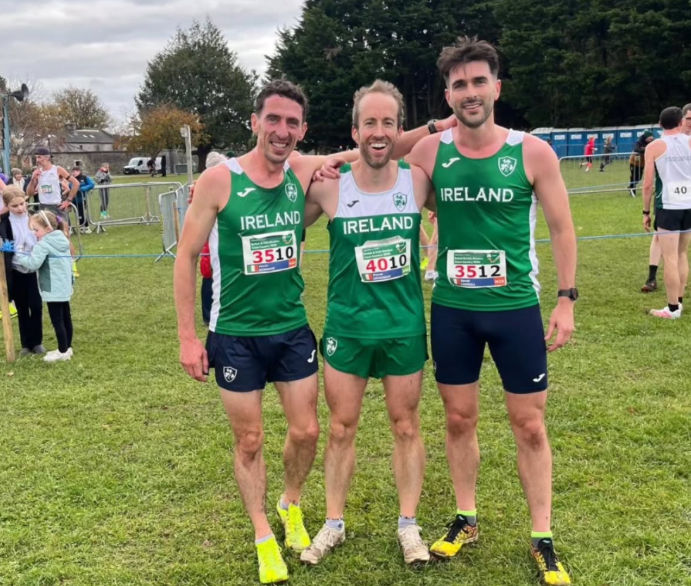

🇮🇪 <strong>A proud day for Liffey Valley AC!</strong> Congratulations to <strong>Pierce Geoghegan</strong> and <strong>David Carroll</strong>, who represented Ireland at the <strong>British & Irish Masters Cross Country Championships</strong>, held on Sunday, 15th November 2026, in Abbotstown, Dublin.

Competing against some of the best masters athletes from across Britain and Ireland, both runners delivered excellent performances over the challenging <strong>8km cross-country course</strong>, proudly wearing the Irish vest.

🏃‍♂️ <strong>Pierce Geoghegan (M40)</strong> produced a fantastic performance, finishing <strong>24th overall in 26:28</strong>, averaging 3:18 per kilometre. Pierce was also part of the <strong>Ireland M40 team that secured an impressive 2nd place</strong> in the team competition!

🏃‍♂️ <strong>David Carroll (M35)</strong> also delivered a strong run, finishing <strong>36th overall in 27:05</strong>, maintaining an excellent average pace of 3:23 per kilometre.

Representing your country is a tremendous achievement and a reflection of the hard work, dedication and consistency both athletes have shown throughout the season.

👏 <strong>Huge congratulations to Pierce and David on their well-deserved international selection and outstanding performances. You've done Liffey Valley AC proud!</strong> 🇮🇪🏃‍♂️

<a href="https://www.instagram.com/p/DfvN_04kYve" target="_blank" rel="noopener noreferrer">Instagram</a>

<figure style="text-align: center;">
  
  <figcaption style="font-size: 1.2em">
    Kevin Minnock, Pierce and David
  </figcaption>
</figure>