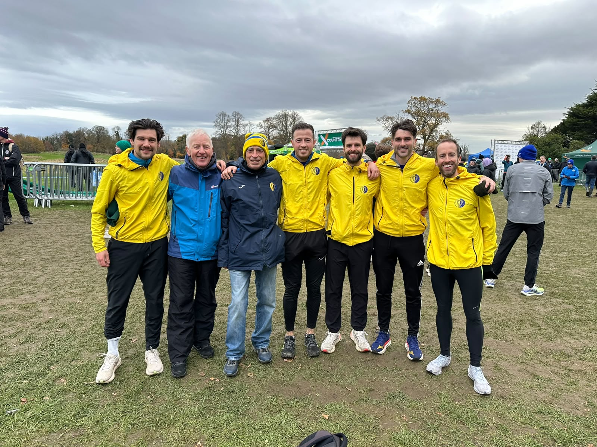
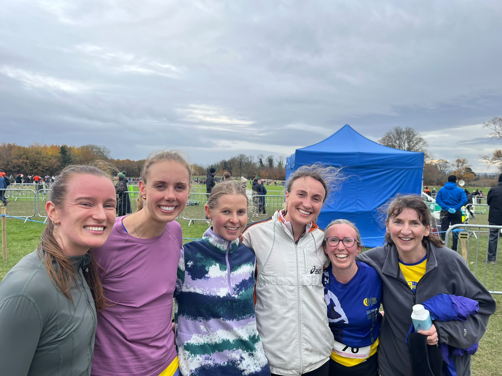

On Sunday, 22 November 2026, the <strong>123.ie National Senior & Even Age Cross Country Championships</strong> took place at the Sport Ireland Campus in Abbotstown, Dublin, bringing together some of Ireland's best distance runners for an exciting day of competition.

Both the men's and women's senior races covered <strong>7.5 km over five laps</strong>, with strong competition throughout the field.

<strong>Congratulations to all 11 Liffey Valley A.C. athletes</strong> who proudly represented the club, with five men and six women competing at national level.

A special congratulations to both our men's and women's teams for finishing <strong>3rd in the Senior Club Grade B category!</strong> A fantastic team achievement and a great representation of Liffey Valley A.C.

Well done to everyone who competed and supported our athletes! 💚💛

<a href="/races/2026-11-22-National-Senior-XC/" target="_blank" rel="noopener noreferrer">Race Results</a>

<a href="https://myrunresults.com/events/123ie_national_senior__even_xc_2026/6230/results?class=senior%20men" target="_blank" rel="noopener noreferrer">MyRunResults</a>

<a href="https://www.instagram.com/liffeyvalleyac/p/DCfSHheAeza/?img_index=1" target="_blank" rel="noopener noreferrer">Instagram</a>

<figure style="text-align: center;">
  
  <figcaption style="font-size: 1.2em">
    Circuit
  </figcaption>
</figure>

<figure style="text-align: center;">
  
  <figcaption style="font-size: 1.2em">
    LVAC Women Team
  </figcaption>
</figure>

<figure style="text-align: center;">
  
  <figcaption style="font-size: 1.2em">
    LVAC Women Team
  </figcaption>
</figure>